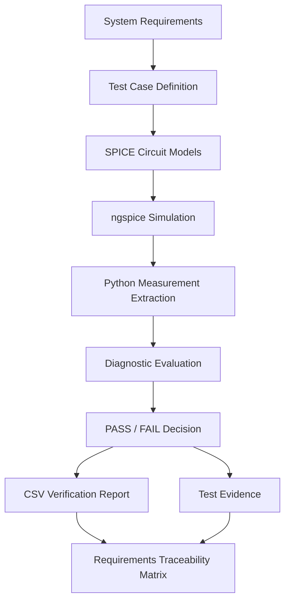

# Medical Hardware Verification Framework


## Project Overview

A simulation-based hardware verification framework focused on electronic subsystems used in medical devices. The project demonstrates circuit analysis, fault injection, automated testing, electrical measurement extraction, test reporting and requirements traceability.

The objective is to develop practical skills in hardware design verification and automated validation using freely available engineering tools.

## Technical Skills Demonstrated

- Electronic circuit analysis
- SPICE-based circuit simulation
- Open and short-circuit fault injection
- Automated electrical measurement extraction
- Python-based test automation
- Diagnostic fault detection
- Automated PASS/FAIL evaluation
- CSV verification report generation
- Requirements Traceability Matrix (RTM)
- Test evidence management
- Git version control

## Tools and Technologies

| Tool | Application |
|---|---|
| ngspice | Electronic circuit simulation |
| Python | Test automation and measurement processing |
| Linux / WSL | Engineering development environment |
| Git | Version control |
| GitHub | Source code and project documentation |
| CSV | Structured verification reporting |

## Verification Architecture



## Experiment 01: Voltage Divider Verification

### Circuit Configuration

- Input voltage: 5 V DC
- Resistor R1: 10 kΩ
- Resistor R2: 20 kΩ

```text
       +5 V
         |
      R1 = 10k
         |
         +-------- Vout
         |
      R2 = 20k
         |
        GND
```

### Theoretical Analysis

Output voltage:

Vout = Vin × R2 / (R1 + R2)

Vout = 5 × 20 / 30

Vout = 3.333333 V

Circuit current:

I = 5 / 30000

I = 0.166667 mA

### Fault Injection

Three circuit operating conditions are evaluated:

| Condition | R2 Value |
|---|---:|
| Normal operation | 20 kΩ |
| Simulated short circuit | 0.001 Ω |
| Simulated open circuit | 1 GΩ |

### Diagnostic Requirements

| Requirement ID | Acceptance Criteria |
|---|---|
| REQ-001 | 3.1 V ≤ Vout ≤ 3.5 V: NORMAL |
| REQ-002 | Vout below 3.1 V: LOW_VOLTAGE_FAULT |
| REQ-003 | Vout above 3.5 V: HIGH_VOLTAGE_FAULT |

### Verification Results

| Test ID | Condition | Measured Voltage | Result |
|---|---|---:|---|
| TC-001 | Normal | 3.333333 V | PASS |
| TC-002 | Short circuit | 0.0000005 V | PASS |
| TC-003 | Open circuit | 4.999950 V | PASS |

**Test Execution Summary**

- Total diagnostic tests: 3
- Passed: 3
- Failed: 0
- Pass rate: 100%

The results demonstrate successful diagnostic classification for the three simulated operating conditions. Additional boundary-value and tolerance testing is planned.

## Repository Structure

```text
medical-hardware-verification/
├── README.md
├── .gitignore
└── fundamentals/
    ├── circuits/
    │   ├── voltage_divider.cir
    │   ├── voltage_divider_short.cir
    │   └── voltage_divider_open.cir
    ├── tests/
    │   ├── run_simulation.py
    │   ├── extract_measurements.py
    │   ├── verify_measurements.py
    │   ├── test_suite.py
    │   ├── csv_practice.py
    │   └── test_suite_report.py
    ├── reports/
    │   ├── practice.csv
    │   ├── verification_report.csv
    │   └── traceability_matrix.csv
    └── evidence/
        ├── TC-001_normal.log
        ├── TC-002_short.log
        ├── TC-003_open.log
        └── test_execution.log
```

## Installation and Execution

### Install Dependencies

```bash
sudo apt update
sudo apt install ngspice python3 git
```

### Clone the Repository

```bash
git clone https://github.com/Kartik-Agnihotry/medical-hardware-verification.git
cd medical-hardware-verification
```

### Run Circuit Simulation

```bash
ngspice -b fundamentals/circuits/voltage_divider.cir
```

### Execute Automated Verification

```bash
python3 fundamentals/tests/test_suite.py
```

### Generate Verification Report

```bash
python3 fundamentals/tests/test_suite_report.py
```

### View Reports

```bash
cat fundamentals/reports/verification_report.csv
cat fundamentals/reports/traceability_matrix.csv
```

## Development Roadmap

### Phase 1 — Electronics and
